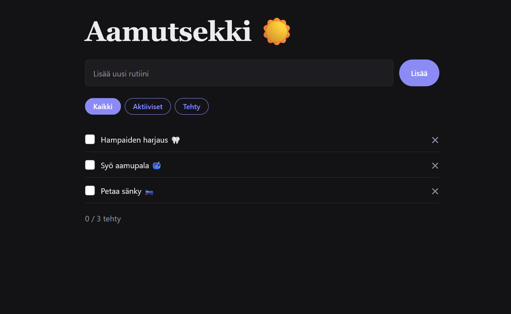

# Aamutsekki

**Tekijä(t):** Mononen Sampo ja Tuunanen Joni

## Projektisuunnitelma

### Projektin idea

Projekti on yksiknkertainen To Do-lista asiosita jotka on hyvä muistaa tehdä ennen kuin lähtee kotoota vaikkapa kouluun.

### Suunnitellut toiminnot

Listaa vähintään kolme sovellukseesi suunniteltua toimintoa:

- Ruksittaa rutiinit tehdyksi
- Tehtävät pystyy suodattamaan tehdyt ja tekemättömät tyylisesti
- Voi lisätä uuden rutiinit haluttaessa

### Rautalankamalli / luonnos

Lisää tähän kuva käsin piirtämästäsi tai digitaalisesti tehdystä sovelluksen luonnoksesta. Luonnoksessa tulee näkyä sovelluksen pääasiallinen näkymä ja tärkeimmät elementit.

Esimerkki kuvan lisäämisestä:

.jpeg)

## Verkkolinkit

- **Julkaistu sovellus:** [Lisää tähän GitHub Pages -osoite](https://yourusername.github.io/your-repository/)
- **GitHub-repositorio:** [Lisää tähän repositorion osoite](https://github.com/yourusername/your-repository)
- **Projektin videoesittely:** [Lisää tähän videon osoite](https://example.com/)

## Tietoja sovelluksesta

**[Aamutsekki]** on verkkosovellus, joka ...

Tarkoitus on toimia sovelluksena joka auttaa hajamielisiä nuoria valmistautumaan helpoilla teoilla joilla saa hyvän alun päivälle. Pienet rakentavat teot luovat hyvä pohjan onnistunneelle päivälle. Täkeimpiä toimintoja ovat mahdollisuus ruksittaa tehdyt teot jotta voi mitata omaa edistymistä ja luoda itselleen onnistumisen tunteen. Vähän niin kuin pelien eteneminen. Samalla voi tarkistaa mitä on vielä tekemättä ennen kuin on niin sanotusti valmis kohtaamaan päivän. 

## Teknologiat

Kuvaile, mitä teknologioita käytit ja mikä niiden rooli oli projektissasi.

- HTML – sivun rakenne 
- CSS – ulkoasu ja asettelu
- JavaScript – toiminnallisuus, DOM-skriptaus ja lomakkeiden validointi
- localStorage – tietojen tallentaminen selaimeen, jos käytit sitä

## Sovelluksen käyttö

Kirjoita lyhyet käyttöohjeet sovellukselle.

1. Avaa julkaistu sovellus yllä olevasta linkistä.
2. Täytä lomakkeen kentät.
3. Lisää, muokkaa, poista tai merkitse kohteita tehdyiksi.
4. Päivitä sivu ja tarkista, säilyvätkö tiedot selaimessa, jos käytit localStoragea.

## Sovelluksen käynnistäminen paikallisesti

1. Kloonaa tai lataa tämä repositorio omalle koneellesi.
2. Avaa projektikansio.
3. Avaa `index.html` selaimessa.

## Kuvakaappaukset

Lisää tähän vähintään yksi kuvakaappaus toimivasta sovelluksestasi.

Esimerkki kuvan lisäämisestä:

## Tunnetut virheet / puutteet

Kerro, jos sovelluksessa on tunnettuja virheitä, puuttuvia toimintoja tai muita rajoituksia.

Jos tunnettuja virheitä ei ole, kirjoita: **Ei tunnettuja virheitä.**

## Työn jakautuminen

*Täytä tämä osio vain, jos teit projektin parityönä.*

Kuvaile, miten työ jakautui ja miten yhteistyö sujui.

- Tekijä 1: ...
- Tekijä 2: ...

## Oma arvio ja oppimisen reflektointi

Pohdi työtäsi ja oppimisprosessiasi.

- Missä onnistuin?
- Mikä oli haastavaa?
- Mitä parantaisin, jos aikaa olisi enemmän?
- Mitä opin HTML:stä, CSS:stä, JavaScriptistä ja DOM-skriptauksesta?
- Mikä jäi epäselväksi tai mistä haluaisin oppia lisää?
- Oma arvio projektista: **xx/10 pistettä**

## Lähteet ja kiitokset

Listaa kaikki projektissa käyttämäsi lähteet, tutoriaalit, kuvat ja koodiesimerkit.

Jos käytit ChatGPT:tä, GitHub Copilotia tai muuta tekoälytyökalua, mainitse se tässä ja kerro lyhyesti, miten se tuki työskentelyäsi.

- [Lähteen tai tutoriaalin nimi](https://example.com/)
- [Kuvalähde](https://example.com/)
- Käytetty tekoälytyökalu: ...
  - Miten työkalua käytettiin: ...

  ## Lisenssi

Tämä projekti on lisensoitu MIT-lisenssillä.

Lisätietoa lisenssin lisäämisestä GitHub-projektiin:
https://docs.github.com/en/communities/setting-up-your-project-for-healthy-contributions/adding-a-license-to-a-repository